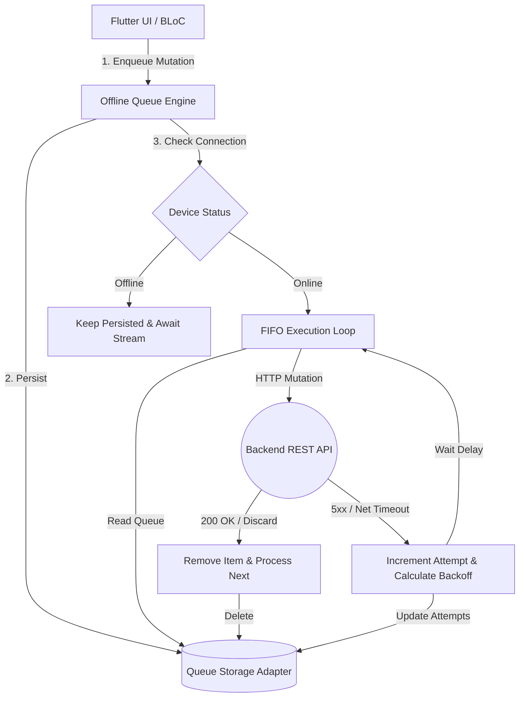

# Resilient Offline Queue (`resilient_offline_queue`)

A clean, modular, and robust offline synchronization queue library for Flutter and Dart applications.

[](https://dart.dev)
[](https://lucasgrf.vercel.app/projects/flutter-offline-queue)
[](https://opensource.org/licenses/MIT)

## 📌 Problem & Context

In mobile networks, connectivity is fragile (subways, rural areas, thick walls). Enqueuing server mutations while offline is easy; keeping them **ordered, persistent, and synchronized without duplicates, race conditions, or battery drainage** is extremely hard. 

`resilient_offline_queue` solves this by decoupling local storage and network monitoring from the queue execution engine. It implements a strict FIFO (First-In, First-Out) mutation synchronization pipeline with resilient retry rules.

---

## ⚡ Key Features

- **📦 Storage Agnostic:** Fully decoupled using `QueueStorage` contract. Back it with SQLite (Drift), Hive, plain files, or Memory.
- **🔄 Exponential Backoff with Jitter:** Avoids flooding your backend servers when coming back online (thundering herd prevention) by introducing randomized ±10% timing offsets.
- **🔒 Race Condition Safe:** Strict lock mechanism ensures a single synchronization routine runs at a time, keeping sequence order intact.
- **⚡ Network Aware:** Triggers synchronization automatically when the device transitions back online.
- **🧪 100% Testable:** Clean architecture layout with abstract adapters makes mocking network and storage interfaces a breeze.

---

## 📐 Architecture Schema

The following blueprint represents how data flows when executing mutations:



---

## 🚀 Getting Started

### 1. Define custom Storage & Network adapters

Implement the interfaces to connect your local storage engine (e.g. SQLite via Drift) and connection monitor:

```dart
import 'package:resilient_offline_queue/resilient_offline_queue.dart';

// SQLite/Drift implementation example
class DriftQueueStorage implements QueueStorage {
  final AppDatabase db;
  DriftQueueStorage(this.db);

  @override
  Future<void> save(QueueItem item) => db.insertQueueItem(item);

  @override
  Future<void> delete(String id) => db.deleteQueueItem(id);

  @override
  Future<void> update(QueueItem item) => db.updateQueueItem(item);

  @override
  Future<List<QueueItem>> getAllPending() => db.getPendingQueueItems();
  
  @override
  Future<int> count() => db.getQueueItemsCount();

  @override
  Future<void> clear() => db.clearQueue();
}
```

### 2. Instantiate and Trigger Queue

Configure the central engine with your adapters and request execution handler:

```dart
final offlineQueue = OfflineQueue(
  storage: DriftQueueStorage(database),
  networkMonitor: MyConnectivityMonitor(),
  executor: (item) async {
    // Execute HTTP mutation using Dio/HTTP client
    try {
      final response = await dio.request(
        item.url,
        data: item.body,
        options: Options(method: item.method, headers: item.headers),
      );
      return response.statusCode != null && response.statusCode! < 300;
    } on DioException catch (e) {
      // 4xx client errors should not be retried (discard from queue)
      if (e.response?.statusCode != null && e.response!.statusCode! < 500) {
        return true; 
      }
      return false; // Triggers temporary backoff retry
    }
  },
);

// Starts background stream subscriptions
offlineQueue.initialize();
```

### 3. Enqueue Mutating Requests

Simply queue requests from anywhere in your repositories/UI:

```dart
await offlineQueue.enqueue(
  id: 'ulid_or_uuid_string',
  url: 'https://api.example.com/v1/materials/cimento',
  method: 'PATCH',
  body: '{"stock": 150}',
);
```

---

## 🧪 Tests Coverage

The engine logic is fully unit-tested. You can find comprehensive suite cases validating transition behaviors in `test/offline_queue_test.dart`.

To run the unit tests:

```bash
dart test
```

## 📄 License

This project is licensed under the MIT License - see the LICENSE file for details.
